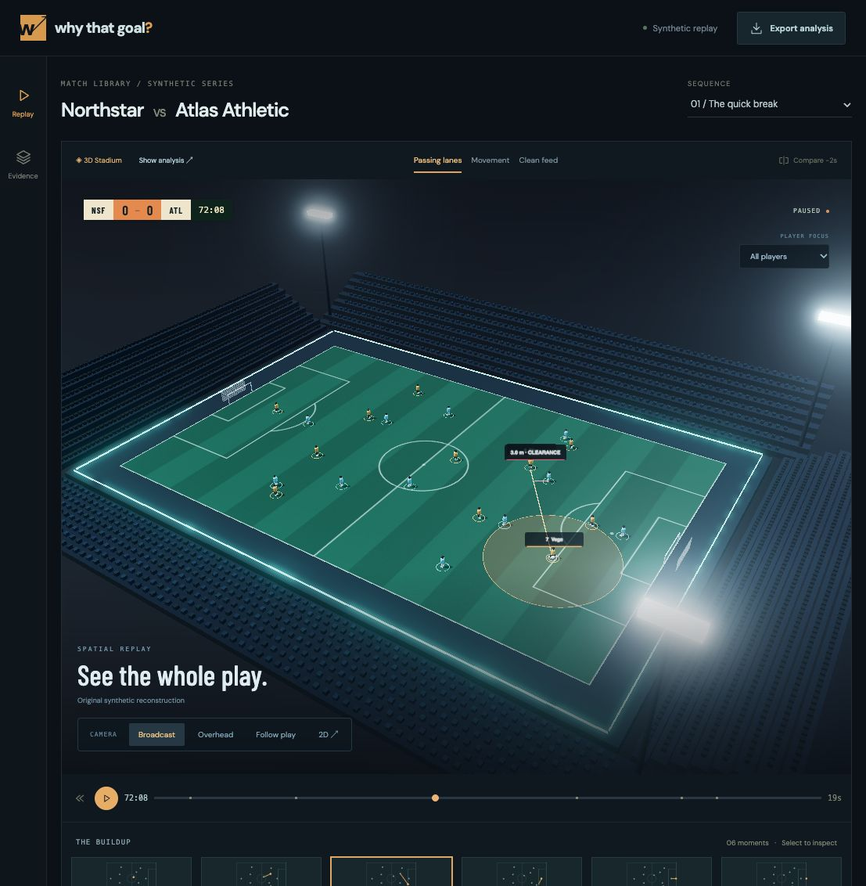

# Why That Goal?

**Rewind the goal. Reveal the buildup. Inspect the evidence.**

A visual football match companion built for Microsoft + Premier League's Inside the Game developer hackathon.

[Innovation Studio project](https://innovationstudio.microsoft.com/hackathons/insidethegamedeveloperhackathon/project/126704)



## Current milestone: interactive 3D replay

This first implementation runs locally without credentials. It includes:

- Six fictional match sequences: two goals, two saves and two intercepted attacks with no shot.
- A Three.js stadium with procedural kits, articulated players, goals, instanced seating, floodlights, shadows and bloom.
- Broadcast, overhead and follow-play cameras; drag to orbit and scroll to zoom.
- Full-width stadium mode, expandable analysis notebook, accessible player selector and 2D fallback.
- Custom sequence/player/language menus with keyboard navigation and typeahead; custom pointer/keyboard replay slider and evidence disclosure.
- Smooth player runs, distance-driven gait, settling touches, timed kicks and goalkeeper reactions.
- Ground-pass deceleration, lofted switches, shot flight and goal/save rebounds.
- Half-speed playback, player focus, trails and replay controls.
- A scoreboard and statistics computed from events visible at the selected time.
- Clickable, versioned event evidence and coordinate-derived passing distances.
- Rule-based fan/analyst explanations in English and Spanish.
- Finite-segment defender clearance and receiving-point space, drawn directly on the pitch.
- Earlier-frame comparison with recomputed spatial measurements.
- Timed JSON overlay and selected-analysis export.
- A revision-aware state engine with duplicate, delayed-arrival and corrected-goal tests.

**No language model is connected in this milestone.** Text is generated from deterministic templates, and the app labels that explicitly. Microsoft Foundry integration, AI evaluation, dedicated Azure hosting and the final video remain work in progress. This is not a final competition submission.

## Run

Use Node.js 22.12+ (Node 24 recommended).

```sh
npm ci
npm run dev
```

Open the Local URL printed by Vite. No Azure key or sports-data subscription is needed.

```sh
npm test
npm run build
npm run preview
```

## Read the play

1. Open into the 3D stadium; select Broadcast, Overhead or Follow play. Drag the scene to orbit, or scroll to zoom.
2. Select another moment in the buildup strip, or use play and the scrubber.
3. Compare positions two seconds earlier; lane and receiving-space distances update.
4. Select a player on the field or with the player-focus dropdown. Follow play tracks that player when selected. Use Show analysis to inspect their coordinates.
5. Switch the geometric layers, audience detail or explanation language.
6. Inspect the evidence or export the analysis. Earlier-frame comparisons are retrospective inspections of the selected event.

## Data and interpretation

All teams, players, events and tracking are fictional, authored in this repository. The pitch uses metres in a 105 × 68 coordinate system. Authored routes are baked into smooth, speed-bounded tracking. Passes have explicit release/arrival timing, ground deceleration or a gravity-based arc; shots terminate at the recorded outcome. Goal and save rebounds are authored damped responses. The seed field is retained as a fixture identifier. This is not a physics-calibrated match simulator or a licensed live feed.

Distance is computed from coordinates. No xG, success probabilities, measured pressing intensity, or causal claims about off-ball movement are presented. Interpolated animation is illustrative; a real event reference does not prove a tactical interpretation.

## Structure

```text
src/core/model.ts       Event visibility, revisions, metrics, templates, exports
src/core/scenarios.ts   Original synthetic match fixtures
src/core/model.test.ts  Event integrity and temporal tests
src/core/spatial.ts     Finite-segment and receiving-point measurements
src/core/spatial.test.ts Geometry edge cases and opponent selection
src/App.tsx            Pitch, replay, evidence and personalization
src/styles.css         Responsive tactical workspace
src/scene/Stadium.tsx   Three.js renderer, procedural scene and camera controls
docs/architecture.md   Data contract, boundaries and next milestones
```

Registration correspondence, account screenshots and private planning notes are excluded from the public repository. No credentials belong in this repository or in frontend environment variables.

## Local evidence backend

Run `npm run dev:api` alongside the frontend to start the loopback-only API on port 8791. It provides validated evidence snapshots and replay moments without model calls. The replay fetches evidence through the Vite `/api` proxy. Start both `npm run dev` and `npm run dev:api`; if the API is unavailable, the notebook shows local fallback and a retry button.

See [backend contract and Foundry handoff](docs/api/intelligence.md) and [OpenAPI specification](docs/api/openapi.json). The server accepts only known scenario IDs and bounded timestamps; a future model adapter can select versioned facts, while trusted code supplies numbers, text and replay coordinates. Foundry setup remains deferred.
