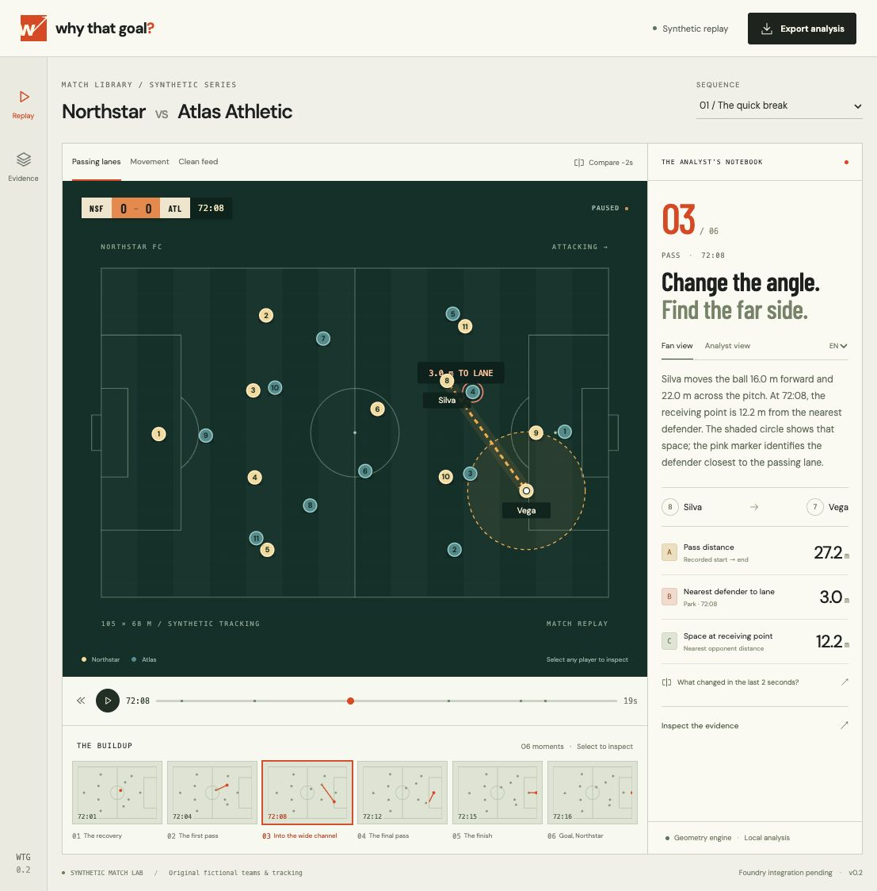

# Why That Goal?

**Rewind the goal. Reveal the buildup. Inspect the evidence.**

A visual football match companion built for Microsoft + Premier League's Inside the Game developer hackathon.

[Innovation Studio project](https://innovationstudio.microsoft.com/hackathons/insidethegamedeveloperhackathon/project/126704)



## Current milestone: tactical replay workspace

This first implementation runs locally without credentials. It includes:

- Three original fictional match sequences, including a sequence that ends in a save.
- An animated 22-player pitch, ball movement, player focus, trails and replay controls.
- A scoreboard and statistics computed from events visible at the selected time.
- Clickable, versioned event evidence and coordinate-derived passing distances.
- Rule-based fan/analyst explanations in English and Spanish.
- Finite-segment defender clearance and receiving-point space, drawn directly on the pitch.
- Earlier-frame comparison with recomputed spatial measurements.
- Timed JSON overlay and selected-analysis export.
- A revision-aware state engine with duplicate, delayed-arrival and corrected-goal tests.

**No language model is connected in this milestone.** Text is generated from deterministic templates, and the app labels that explicitly. Microsoft Foundry integration, AI evaluation, dedicated Azure hosting and the final video remain work in progress. This is not a final competition submission.

## Run

Use Node.js 22.12+ (Node 24 recommended).

```sh
npm ci
npm run dev
```

Open the Local URL printed by Vite. No Azure key or sports-data subscription is needed.

```sh
npm test
npm run build
npm run preview
```

## Read the play

1. Open directly into a selected pass and its pitch annotation.
2. Select another moment in the buildup strip, or use play and the scrubber.
3. Compare positions two seconds earlier; lane and receiving-space distances update.
4. Select a player to inspect their current coordinates.
5. Switch the geometric layers, audience detail or explanation language.
6. Inspect the evidence or export the analysis. Earlier-frame comparisons are retrospective inspections of the selected event.

## Data and interpretation

All teams, players, events and tracking are fictional, authored in this repository. The pitch uses metres in a 105 × 68 coordinate system. A seeded generator creates background player movement; keyframes illustrate the authored event sequences. This is not a physics-calibrated match simulator or a licensed live feed.

Distance is computed from coordinates. No xG, success probabilities, measured pressing intensity, or causal claims about off-ball movement are presented. Interpolated animation is illustrative; a real event reference does not prove a tactical interpretation.

## Structure

```text
src/core/model.ts       Event visibility, revisions, metrics, templates, exports
src/core/scenarios.ts   Original synthetic events and seeded tracking
src/core/model.test.ts  Event integrity and temporal tests
src/core/spatial.ts     Finite-segment and receiving-point measurements
src/core/spatial.test.ts Geometry edge cases and opponent selection
src/App.tsx            Pitch, replay, evidence and personalization
src/styles.css         Responsive tactical workspace
docs/architecture.md   Data contract, boundaries and next milestones
```

Registration correspondence, account screenshots and private planning notes are excluded from the public repository. No credentials belong in this repository or in frontend environment variables.
